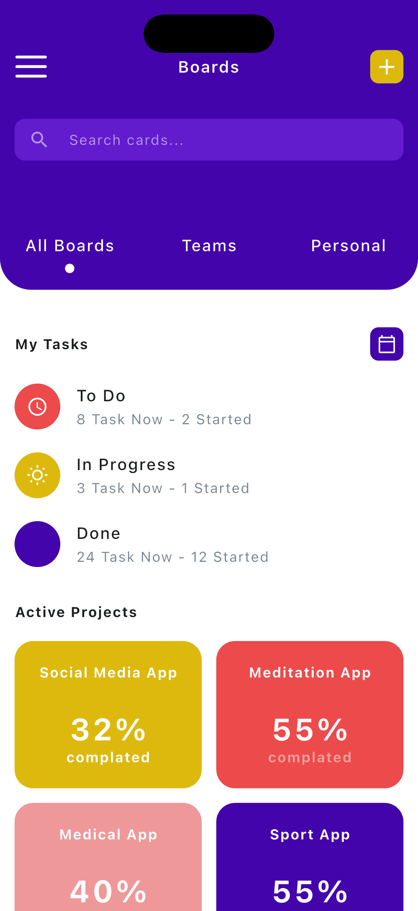
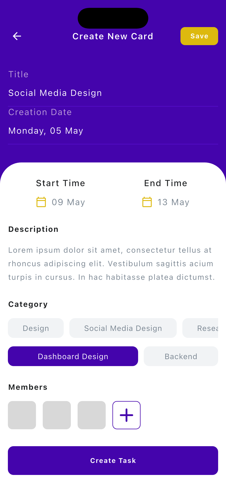
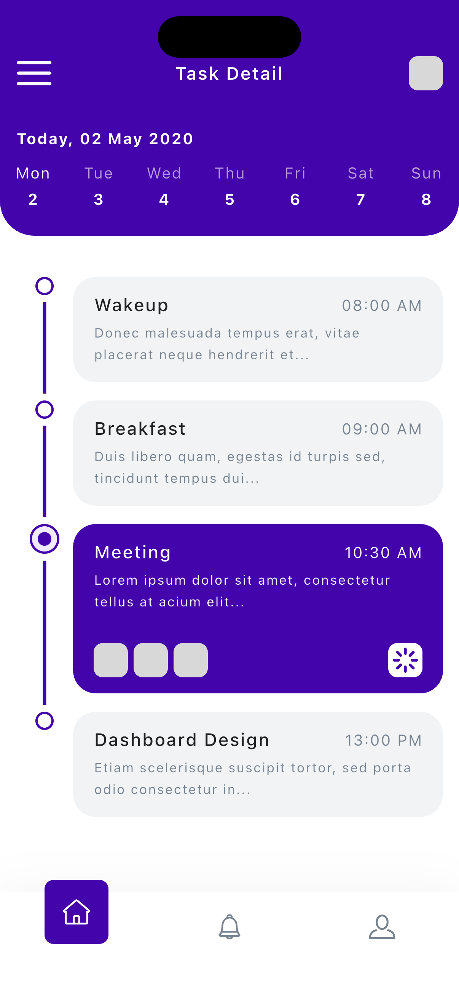
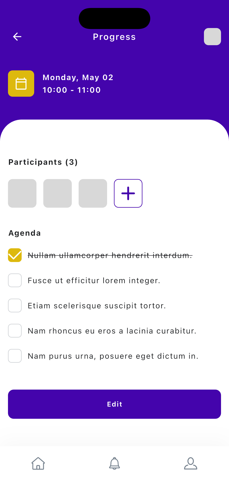
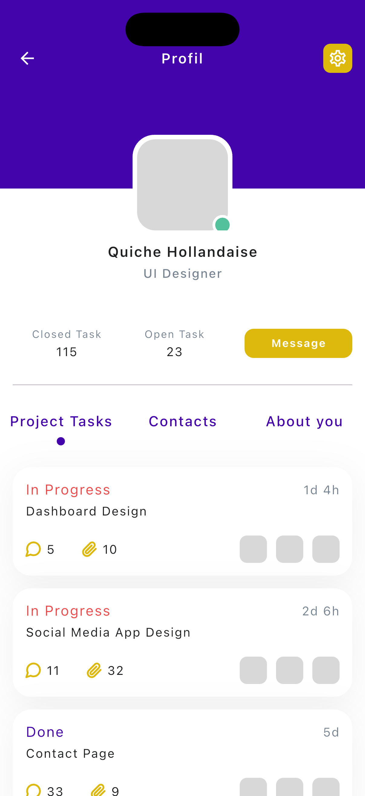

# 页面截图

`design_reference/` 是 Pixso 原稿；`screenshots/` 是 Flutter 在 iPhone 模拟器中的实际运行截图。

## 主页面

| 序号 | 页面 | App 截图 | Pixso 原稿 |
| --- | --- | --- | --- |
| 01 | 看板 | [01_boards.png](screenshots/01_boards.png) | [参考](design_reference/01_boards.png) |
| 02 | 新建卡片 | [02_create_card.png](screenshots/02_create_card.png) | [参考](design_reference/02_create_card.png) |
| 03 | 任务日程 | [03_task_detail.png](screenshots/03_task_detail.png) | [参考](design_reference/03_task_detail.png) |
| 04 | 进度清单 | [04_progress.png](screenshots/04_progress.png) | [参考](design_reference/04_progress.png) |
| 05 | 个人资料 | [05_profile.png](screenshots/05_profile.png) | [参考](design_reference/05_profile.png) |

## 辅助界面

| 页面 | 截图 |
| --- | --- |
| 联系人 | [06_contacts.png](screenshots/06_contacts.png) |
| 关于自己 | [07_about.png](screenshots/07_about.png) |
| 个人设置 | [08_settings.png](screenshots/08_settings.png) |
| 通知列表 | [09_notifications.png](screenshots/09_notifications.png) |
| 侧边菜单 | [10_menu.png](screenshots/10_menu.png) |
| 日期选择 | [11_date_picker.png](screenshots/11_date_picker.png) |
| 成员选择 | [12_member_picker.png](screenshots/12_member_picker.png) |
| 议程编辑 | [13_agenda_editor.png](screenshots/13_agenda_editor.png) |
| 消息入口 | [14_messages.png](screenshots/14_messages.png) |

## 预览

### 看板



### 新建卡片



### 任务日程



### 进度清单



### 个人资料



## 重新生成

```sh
flutter drive --driver test_driver/integration_test.dart \
  --target integration_test/app_test.dart -d <ios-simulator-id>
```

截图由集成测试驱动，在界面动画稳定后使用 iOS 模拟器原生接口采集，分辨率为 1206 × 2622。主页面截图使用初始演示数据，部分辅助截图包含测试创建的任务与编辑状态；系统安全区域、手机宽高与原稿有差异时，实际界面使用可滚动布局适配。
